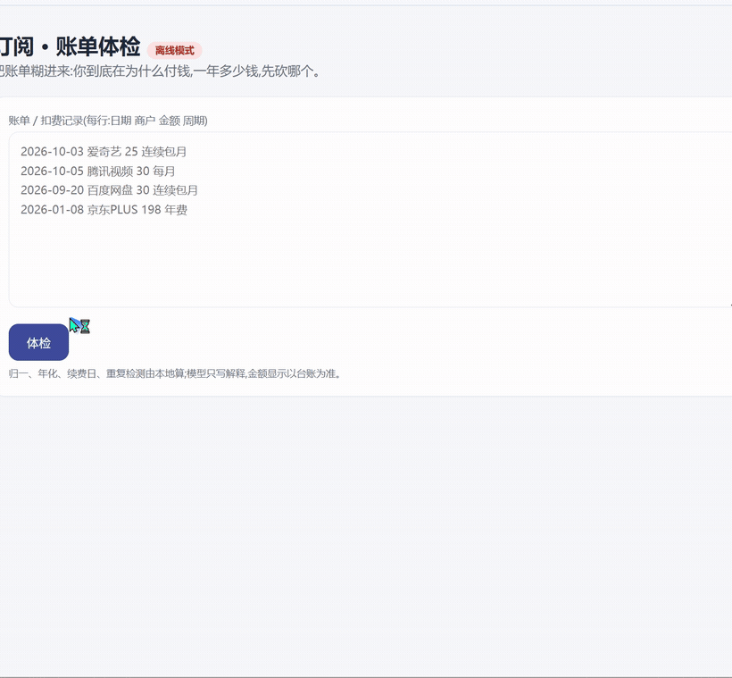
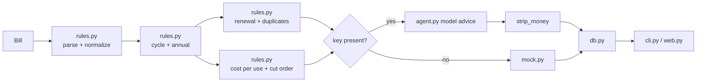

# DingYue · Subscription Bill Checkup

[](https://github.com/wushiyi105-jpg/dingyue/actions) []() [](./LICENSE) [](https://codecov.io/gh/wushiyi105-jpg/dingyue)



> Paste a bill or a pile of emails: see what you are actually paying for, what it costs a year, and which one to cut first.

Subscription accounting is hard because the same service appears under several names, monthly/quarterly/yearly charges mix, and renewal dates differ. This tool normalises merchants, annualises each cycle, derives renewal dates with `calendar.monthrange`, groups duplicates, and ranks what to cut by cost per use.

**CLI + Web, zero third-party dependencies.**

## ✨ Features

- 🔎 **120-merchant normalisation** — 爱奇艺 / iQiyi / 奇艺 and 腾讯视频 / Tencent Video resolve to one entry, across video, music, cloud storage, AI, software, memberships, learning, fitness, news and games
- 📅 **Cycle and annualisation** — monthly ×12, quarterly ×4, half-year ×2, yearly ×1; same merchant with different amounts is flagged separately
- 🗓 **Renewal dates that hold** — periods are added with `calendar.monthrange`, so Jan 31 monthly lands on Feb 28, and Feb 29 yearly lands on Feb 28 next year
- 🔁 **Duplicate detection** — three video memberships or two cloud drives are grouped with their combined annual cost
- ✂️ **Cut order** — with monthly usage counts it computes cost per use; the less you use and the more it costs a year, the earlier it appears
- ↩️ **Refund window** — remaining days from the merchant's refund rule, with a warning when only 3 days are left
- 🔒 **Amounts stay local** — ledger, annualisation and totals are computed locally; any amount in model prose is replaced, never rewritten

## 🚀 Quick start

```bash
git clone https://github.com/wushiyi105-jpg/dingyue.git
cd dingyue

cp .env.example .env      # optional: LLM_API_KEY

python -m dingyue scan --text "2026-10-03 iQiyi 25 monthly"
```

Each line is `date merchant amount [cycle]`; merchant aliases are accepted.

Docker:

```bash
docker build -t dingyue .
docker run -p 8000:8000 dingyue
```

## 🤔 Why not just ask a general LLM

A general model says "you have too many subscriptions, cut the unused ones". It cannot compute what you pay a year, and it cannot order renewal dates. Four differences:

1. **Annualisation is multiplication** — 25/month → `25 × 12 = 300`; 198/year → `198 × 1 = 198`. Four lines total `1218`, about `101.5` a month. Every step is reproducible with `rules.parse_bill()`, and models routinely mis-handle quarterly and half-year cycles.
2. **Renewals are clamped to month length** — `rules.next_renewal(date(2026,1,31),"月")` returns `2026-02-28`, not March 3. Yearly charges across a leap year also clamp to Feb 28. That is `calendar.monthrange`, not "about next month".
3. **Duplicates are grouped** — two video entries become one group with an annual total of 660. A model says "too many memberships" without telling you which two overlap.
4. **Cutting is cost per use** — 300/year at 2 uses a month is 12.5 per use; 360/year at 20 uses is 1.5. `rules.cut_order()` puts the first one first. A model does not have your usage counts.

## 🎯 Use cases

- **New-year checkup**: paste last year's charges, see the annual total and category mix.
- **Hidden renewals**: forgotten monthly plans and trials that converted show up line by line.
- **Trimming one category**: keep one of three video memberships, decided by cost per use.
- **Before renewal**: list the next dates and cancel 24 hours ahead.
- **Refund decisions**: just charged and still inside the window, check the days left.

## 🗺 Roadmap

- **Email import**: pull billing emails over IMAP and extract by template instead of pasting.
- **Price tracking**: plot amount history per merchant and flag increases.
- **Family sharing split**: annual cost per head in a family group.
- **Reminders**: 3 days before renewal and the last day of the refund window.
- **Multi-currency**: convert to one currency while keeping the original amount.

## ❓ FAQ

**What if the merchant name is messy?**
`rules.normalize()` does substring matching over names and aliases and takes the longest hit. `python -m dingyue merchant --name "iQiyi"` shows the resolved entry and cancellation path.

**Why doesn't my annual total match the bank?**
`parse_bill()` annualises the amount and cycle you wrote, excluding tax, FX and discounts. When a bill has a discount, enter the amount actually charged.

**How are quarterly and half-year charges handled?**
`FACTOR = {"月":12,"季":4,"半年":2,"年":1}`; renewals add 3 or 6 months.

**Is "next renewal" a prediction?**
It adds one period to the last charge date and does not include merchant grace periods. It is for reminders; the merchant's charge is authoritative.

**Will the model change an amount?**
No. The ledger, annualisation and totals are rendered locally; any amount in model prose is replaced by `agent.strip_money()`, and the cut order may only reference the local ranking.

## 📖 Commands

```bash
# 💳 scan a bill
python -m dingyue scan --file bill.txt
python -m dingyue scan --text "2026-10-03 iQiyi 25 monthly" --uses "iQiyi:2" --save

# 🏪 merchant lookup
python -m dingyue merchant --name "iQiyi"

# 📅 renewal calendar only
python -m dingyue next --file bill.txt

# 🗂 history
python -m dingyue history

# 🌐 web
python -m dingyue web --port 8000

python -m dingyue --json scan --file bill.txt
python -m dingyue --mock scan --file bill.txt
```

## 🔌 Model configuration

Any **OpenAI-style `/chat/completions`** endpoint:

| Platform | `LLM_BASE_URL` | `LLM_MODEL` |
|---|---|---|
| DeepSeek (default) | `https://api.deepseek.com` | `deepseek-flash` |
| OpenAI | `https://api.openai.com/v1` | `gpt-4o-mini` |
| Local Ollama | `http://localhost:11434/v1` | `qwen2.5` |

## 🧠 How it works

```
bill text
  │
  ├─ rules.parse_bill ─── date / merchant / amount / cycle
  ├─ rules.normalize ──── 120-entry normalisation (names + aliases)
  ├─ rules.infer_cycle ── monthly / quarterly / half-year / yearly
  ├─ rules.next_renewal ─ calendar.monthrange clamp
  ├─ rules.consistency ── same merchant, different amounts
  ├─ rules.duplicates ─── multiple subscriptions per category
  ├─ rules.cost_per_use ─ annual ÷ (monthly uses × 12)
  ├─ rules.cut_order ──── ranking by cost per use
  ├─ rules.refund_window remaining refund days
  │
  ├─ model: summary / advice / risks (amounts replaced)
  └─ offline: mock.py same-shape draft
  │
  └─ SQLite → CLI / Web
```

### Data flow



## 🗂 Layout

```
dingyue/
├── dingyue/
│   ├── rules.py    # normalisation, cycle, annual, renewal, duplicates, cost per use
│   ├── agent.py    # orchestration + amount replacement
│   ├── mock.py     # offline same-shape draft
│   ├── db.py       # ledgers and subscriptions
│   ├── cli.py      # scan / merchant / next / history / web
│   └── web.py      # single page + JSON API
├── data/merchants.json # 120-merchant normalisation table
├── tests/test_dingyue.py
└── assets/demo.gif
```

## ✅ Tests

```bash
python -m unittest discover tests -v
```

30 tests: normalisation and aliases, five cycle inferences, month-end and leap-year clamping, bill parsing, unknown merchants skipped, annual totals, duplicates and amount mismatches, cost per use, cut order, refund windows, offline shape and amount replacement. CI runs on 3.10/3.11/3.12.

## 👤 Author

shiyi · GitHub [@wushiyi105-jpg](https://github.com/wushiyi105-jpg) · [wushiyi105@gmail.com](mailto:wushiyi105@gmail.com)

## 📄 License

[MIT](./LICENSE)
