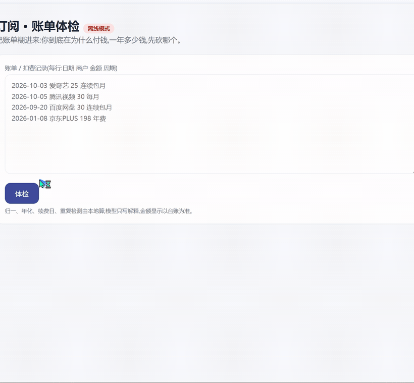
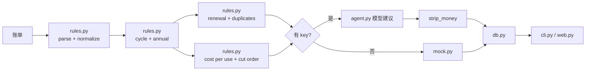

# 订阅 · 账单体检

[](https://github.com/wushiyi105-jpg/dingyue/actions) []() [](./LICENSE) [](https://codecov.io/gh/wushiyi105-jpg/dingyue)



> 把账单或邮件糊进来,认出来你到底在为什么付钱,一年多少钱,先砍哪个。

订阅的账最难算,因为同一家会写好几种名字、月付季付年付混在一起、扣费日各不相同。这个工具先把商户名归一,再把周期折成年化,按 `calendar.monthrange` 排出续费日,标出同类重复,最后按单次成本给砍单顺序。

**CLI + Web,零第三方依赖。**

## ✨ 特性

- 🔎 **120 条商户归一** — 爱奇艺 / iQiyi / 奇艺、腾讯视频 / Tencent Video 都归到同一家,覆盖视频、音乐、云存储、AI、软件、会员、学习、健身、新闻、游戏十类
- 📅 **周期与年化** — 月付 ×12、季付 ×4、半年 ×2、年付 ×1;同一商户不同金额单独标记
- 🗓 **续费日算得准** — 按 `calendar.monthrange` 加周期,1 月 31 日的月付落到 2 月 28 日,2 月 29 日的年付落到次年 2 月 28 日
- 🔁 **重复检测** — 视频类三个会员、云盘两个一起扣,按类别聚合并给出年化合计
- ✂️ **砍单顺序** — 填入月使用次数,算单次成本;使用越少、年化越高越靠前
- ↩️ **退款窗口** — 按商户退款规则算剩余天数,3 天内会单独提醒
- 🔒 **金额只认本地** — 台账、年化、合计全部本地算;模型文字里出现金额会被替换,不许改写

## 🚀 快速开始

```bash
git clone https://github.com/wushiyi105-jpg/dingyue.git
cd dingyue

cp .env.example .env      # 可选:LLM_API_KEY

python -m dingyue scan --text "2026-10-03 爱奇艺 25 连续包月"
```

每行 `日期 商户 金额 [周期]`,商户名可以是别名。

Docker:

```bash
docker build -t dingyue .
docker run -p 8000:8000 dingyue
```

## 🤔 为什么不用通用大模型直接问

通用模型会说「你订阅有点多,建议砍掉不常用的」。它算不出你一年到底付了多少,也排不出下次续费日。差别在四点:

1. **年化是乘出来的** — 爱奇艺 25/月 → `25 × 12 = 300`;京东 PLUS 198/年 → `198 × 1 = 198`。四行账单合计 `1218`,约每月 `101.5`。每一步都能用 `rules.parse_bill()` 复算,模型的口算经常在季付、半年付上出错。
2. **续费日按月份长度夹取** — `rules.next_renewal(date(2026,1,31),"月")` 返回 `2026-02-28`,不是 3 月 3 日。年付跨闰年同样夹到 2 月 28 日。这是 `calendar.monthrange` 的硬算,不是「大概下个月」。
3. **重复是聚合出来的** — 视频类出现爱奇艺与腾讯视频两条,`rules.duplicates()` 聚成一条,年化合计 660。模型只会泛泛说「会员太多」,给不出哪两类在重叠。
4. **砍单看单次成本** — 爱奇艺 300/年、每月用 2 次 → 单次 12.5 元;腾讯视频 360/年、每月 20 次 → 单次 1.5 元。排序按 `rules.cut_order()`,先砍爱奇艺。模型没有你的使用次数,只能猜。

## 🎯 适用场景

- **年初体检**:把去年扣费记录贴进来,看年化总额和类别占比。
- **发现隐形续费**:连续包月忘关的、试用到期自动转正的,一行一行看得见。
- **同类别瘦身**:三个视频会员留一个,依据是单次成本而不是感觉。
- **续费前提醒**:下次续费日排出来,到期前 24 小时关自动续费。
- **退款决策**:刚扣费又在窗口内,先看还剩几天。

## 🗺 Roadmap

- **邮件自动导入**:IMAP 拉取扣费邮件,按模板抽取,不用手贴。
- **涨价追踪**:同一商户历史金额变化画曲线,涨价自动标记。
- **共享账号拆分**:家庭组按人头摊年化,算清谁该付多少。
- **提醒推送**:续费前 3 天与退款窗口最后 1 天提醒。
- **多币种**:按汇率折算统一币种,保留原始金额。

## ❓ FAQ

**商户名写得不规范怎么办?**
`rules.normalize()` 用名称与别名做包含匹配,取最长命中。`python -m dingyue merchant --name "iQiyi"` 可以直接看归一结果与取消路径。

**为什么我的年化和银行扣款对不上?**
`parse_bill()` 按你写的金额与周期折算,不含税费、汇率与优惠。账单里有折扣时,按实际扣费金额填写。

**季付、半年付怎么算?**
`FACTOR = {"月":12,"季":4,"半年":2,"年":1}`,季付 ×4、半年 ×2,续费日按 3 / 6 个月加。

**「下次续费」是预测吗?**
是按上次扣费日加一个周期算的,不含商户宽限期。实际以商户扣款为准,这里用于提醒。

**模型会改金额吗?**
不会。台账、年化、合计都由本地渲染;模型输出的文字若出现金额,`agent.strip_money()` 会替换掉,顺序也只允许引用本地排序。

## 📖 命令参考

```bash
# 💳 扫账单
python -m dingyue scan --file bill.txt
python -m dingyue scan --text "2026-10-03 爱奇艺 25 连续包月" --uses "爱奇艺:2" --save

# 🏪 查商户
python -m dingyue merchant --name "iQiyi"

# 📅 只看续费日历
python -m dingyue next --file bill.txt

# 🗂 历史
python -m dingyue history

# 🌐 Web
python -m dingyue web --port 8000

python -m dingyue --json scan --file bill.txt
python -m dingyue --mock scan --file bill.txt
```

## 🔌 模型接入

兼容 **OpenAI `/chat/completions`** 的任意服务:

| 平台 | `LLM_BASE_URL` | `LLM_MODEL` |
|---|---|---|
| DeepSeek(默认) | `https://api.deepseek.com` | `deepseek-flash` |
| OpenAI | `https://api.openai.com/v1` | `gpt-4o-mini` |
| 本地 Ollama | `http://localhost:11434/v1` | `qwen2.5` |

## 🧠 工作原理

```
账单文本
  │
  ├─ rules.parse_bill ─── 日期 / 商户 / 金额 / 周期
  ├─ rules.normalize ──── 120 条归一(名称 + 别名)
  ├─ rules.infer_cycle ── 月 / 季 / 半年 / 年
  ├─ rules.next_renewal ─ calendar.monthrange 夹取
  ├─ rules.consistency ── 同商户不同金额
  ├─ rules.duplicates ─── 同类别多订阅
  ├─ rules.cost_per_use ─ 年化 ÷ (月次数 × 12)
  ├─ rules.cut_order ──── 单次成本排序
  ├─ rules.refund_window 剩余退款天数
  │
  ├─ 模型:摘要 / 建议 / 风险(金额替换)
  └─ 离线:mock.py 同结构草稿
  │
  └─ SQLite → CLI / Web
```

### 数据流



## 🗂 目录结构

```
dingyue/
├── dingyue/
│   ├── rules.py    # 归一、周期、年化、续费日、重复、单次成本、退款窗口
│   ├── agent.py    # 编排 + 金额替换
│   ├── mock.py     # 离线同结构草稿
│   ├── db.py       # 台账与订阅
│   ├── cli.py      # scan / merchant / next / history / web
│   └── web.py      # 单页 + JSON API
├── data/merchants.json # 120 条商户归一表
├── tests/test_dingyue.py
└── assets/demo.gif
```

## ✅ 测试

```bash
python -m unittest discover tests -v
```

30 个单测:归一与别名、周期推断五种、续费日月末夹取与闰年、账单解析、未识别商户跳过、年化合计、重复与金额不一致、单次成本、砍单顺序、退款窗口、离线结构与金额替换。CI 在 3.10/3.11/3.12 上跑。

## 👤 作者

shiyi · GitHub [@wushiyi105-jpg](https://github.com/wushiyi105-jpg) · [wushiyi105@gmail.com](mailto:wushiyi105@gmail.com)

## 📄 License

[MIT](./LICENSE)
